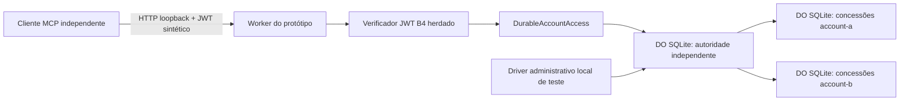

# B4 — 2B.2-A: concessões persistentes sintéticas

Base: `dd2933d1c1d39e76e8d9011048666933be6b2eb6`. Implementação exclusivamente local, sem configuração Wrangler, migrações de produção, novas dependências ou conexão com serviços reais.

## Composição e fronteiras



`src/worker.ts` neste subprojeto continua expondo somente `/mcp`, em `http://127.0.0.1`, com os limites HTTP e as três ferramentas existentes. Nenhum entrypoint do Worker da raiz foi alterado. A composição persistente é `tests/fixtures/persistent-worker.ts`, compilada por `scripts/build-persistence.mjs`; não há endpoint administrativo, ferramenta comercial de escrita ou binding de produção.

O modo original em memória permanece para os 71 testes de regressão. A composição persistente exige explicitamente `SYNTHETIC_POLICY=persistent`; falta/indisponibilidade da autoridade nunca seleciona a política em memória. A opção de modo não é controlada pelo cliente.

O padrão B3.1 reutilizado é `DurableObject` + `storage.sql.exec` com parâmetros + `transactionSync`. As classes e tabelas são novas e locais; não reutilizam nem migram os cofres B3.1. Há uma partição de concessões por conta interna, sem tokens Mercado Livre ou dados de cofres operacionais.

## Modelo

| Registro | Campos e regra |
|---|---|
| Operador | SHA-256/base64url de `issuer + NUL + sub`, habilitado, revisão CAS |
| Conta | Referência interna e nome de partição definidos pelo servidor; duas fixtures |
| Concessão/projeção | Operador, conta, permissões distintas `read`/`connect`, início/fim em ms, revisão positiva; schema fechado; validade máxima 24 h |
| Âncora independente | Par operador/conta, revisão monotônica, `pending`/`active`/`revoked`, digest canônico da concessão |
| Auditoria | Sequência, horário, evento, conta interna, pseudônimo do operador, revisão, permissão e classe de ator |

O JWT deve passar pela verificação herdada de assinatura RS256, issuer, audience, sub, tipo e validade. O pseudônimo passado à política vem desse resultado verificado. `account_ref` é apenas um seletor submetido à autorização; não cria vínculo. Identidade, `seller_id`, papel e permissões enviados pelo cliente não conferem direitos. A busca do anúncio continua restrita aos itens da conta autorizada. Textos retornados permanecem dados não confiáveis.

Cada chamada consulta novamente o armazenamento. Registro ausente, operador desabilitado, validade expirada/futura, divergência de revisão/digest, estado pendente/revogado ou falha de armazenamento bloqueiam a leitura. Não há cache positivo ou autorização por e-mail/claims adicionais. `read` não concede `connect`; `connect` não concede `read`; nenhum deles concede administração. A integração MCP usa exclusivamente `read`; nenhum fluxo real de conexão foi adicionado.

## Atualizações, revogação e concorrência

Uma atualização exige `expectedRevision` exata. Em transação SQLite, a autoridade reserva a próxima revisão como `pending`, registra auditoria e aguarda `storage.sync()`. Só então persiste a projeção na partição correspondente. Após conferir que a reserva ainda é vigente, marca `active`, audita e aguarda novo `sync()` antes de confirmar. Falhas/interrupções deixam uma cerca `pending`, sem reaproveitar a permissão anterior. Não há transação distribuída ou reparo automático; o comportamento é negar até futura recuperação administrativa.

A revogação grava um tombstone e seu evento na mesma transação, avança a revisão e aguarda `storage.sync()` antes de retornar sucesso. Não depende da atualização/remoção da projeção: uma cópia antiga continua bloqueada pela autoridade. Se a confirmação se perder após o flush, a revogação já fica efetiva. Se houver erro, o chamador não deve afirmar que houve confirmação; consulta/reconciliação é necessária.

Atualizações concorrentes com a mesma revisão têm um vencedor. Uma revogação pode superar uma atualização pendente; a finalização antiga falha no CAS. Neste estágio, revogação é terminal para o par operador/conta: não há reativação/regrant nem desbloqueio automático de atualizações pendentes. Nova concessão após revogação exige outro desenho aprovado, sem apagar tombstones.

A decisão de autorização lineariza na leitura final da autoridade, depois dos awaits da projeção e de seu digest. Toda chamada iniciada após uma revogação confirmada é negada. Uma chamada já autorizada antes dessa leitura de revogação pode terminar; não há cancelamento retroativo de respostas em voo. Descoberta de ferramentas continua disponível a identidades JWT válidas; ela contém schemas públicos, sem dados das contas.

## Restauração: garantia e limite obrigatório

O registro de autoridade/revogações é uma referência independente e **não faz parte do conjunto restaurável das projeções**. No harness são namespaces SQLite distintos. A concessão restaurada precisa coincidir com revisão, digest e estado ativo atuais. Os testes realizam cópia e rollback físico do namespace de projeções com todos os runtimes encerrados, além de importação de versões antigas: a revogação permanece.

Se a autoridade desaparecer, o armazenamento novo não possui âncoras e nega. A inicialização explícita das duas identidades/contas não recria concessões e nunca reabilita um operador existente. Não há seed automático de concessões no reinício.

**Limite:** a separação local não torna o ledger inviolável. Restaurar deliberadamente uma cópia antiga tanto da autoridade quanto das projeções pode reativar uma concessão antiga. Um sistema fechado não distingue esse estado de seu passado legítimo sem uma referência externa. A garantia desta etapa exige preservar a autoridade vigente. Nenhum procedimento de restauração completa está autorizado ou implementado.

Antes de restauração operacional, aprovar uma referência monotônica independente do domínio de backup, ou bloquear integralmente a autorização durante recuperação e exigir reconciliação/revalidação administrativa. Um marcador guardado no mesmo backup não resolve rollback completo. A gestão real dessa âncora, permissões de backup, identidade administrativa e recuperação pertencem a uma etapa posterior; não foram simuladas como segurança de produção.

## Administração, auditoria e falhas

Somente o driver local privilegiado acessa as RPCs de inicialização/atualização/revogação. Nenhuma credencial de operador ou permissão `read`/`connect` dá acesso a essas RPCs por HTTP/MCP. A fronteira administrativa atual é a posse do runtime/binding no processo de teste, sem alegação de autenticação administrativa real. A auditoria identifica esse ator como `local-administration`; decisões MCP usam `verified-operator` e o pseudônimo verificado. Consultas diretas do driver são `local-policy-inspection`.

Os eventos não armazenam JWT, headers, tokens, chave privada, e-mail, anúncio, preço ou argumentos livres. Falhas no armazenamento da auditoria durante uma decisão também impedem sucesso. Durante indisponibilidade total, não se promete um evento persistido; o resultado permanece negação. A consulta de auditoria limita-se aos 200 eventos mais recentes; retenção, exportação protegida, capacidade e resistência a adulteração por administrador do host ainda precisam de projeto operacional.

Os hooks de falha/restauração existem somente em subclasses do fixture. Eles simulam indisponibilidade, erro de projeção, interrupção após persistência e concorrência com atualização pendente. Não são flags de requisição ou rotas adicionais.

O Miniflare fixado apresenta falha no proxy Node ao decodificar certas promessas RPC rejeitadas (`typeHeader === Promise`). O fixture administrativo converte exclusivamente erros conhecidos ocorridos dentro de workerd em envelopes fechados, e o driver os valida antes de lançar `SyntheticManagementError`. Erros desconhecidos e de transporte não são convertidos. Os testes injetam `ECONNRESET`, timeout e conexão recusada nessa fronteira. Nenhum pacote, SDK ou lockfile foi alterado para contornar o problema.

## Reprodução e incorporação proposta

```sh
# Raiz do checkout isolado
npm ci --ignore-scripts
npm run typecheck
npm test
node scripts/tooling.mjs test --config vitest.b3.config.ts
npm run test:registry
npm audit --audit-level=low

cd prototype/mcp-local
npm ci --ignore-scripts
npm run typecheck
npm exec -- tsc --noEmit -p tsconfig.persistence.json
npm run build:local
node --test tests/interoperability.test.mjs tests/hardening.test.mjs # 71 anteriores
node --test tests/persistence.test.mjs # 42 novos
npm test # descoberta conjunta: 113
npm run demo
npm audit --audit-level=low
```

O cache npm precisa apontar para uma pasta local gravável. Quando necessário, passar `--cache <pasta-local>`; não mudar versões ou integridades. `work/` é ignorado. Os testes removem seus bancos temporários, fecham clientes/runtimes e verificam recursos do harness e portas recusando conexão. As evidências sanitizadas ficam em `work/persistence-evidence.json`; a saída do runner é a fonte de resultado final, incluindo erros de teardown.

Os 42 casos abrangem quatro combinações de operador/perfil, negação por padrão e falhas de binding, adulteração de claims/projeções, permissões/validade, operador desabilitado, reinícios/JWT original, confirmação perdida, CAS/concorrência, atualizações pendentes, indisponibilidade, isolamento de partições, restauração física, auditoria e separação de falhas de transporte. Os 71 anteriores incluem os 11 cenários de encerramento. Os números não somam novamente esses 11 ao total.

Proposta: incorporar somente os fontes/testes/documentos desta etapa na branch B4, após auditoria, nova conferência de hashes e aprovação. Não incluir bancos, bundles, caches, logs, relatórios privados ou manifestos. O workflow existente usa `tests/*.test.mjs` e descobrirá os 113 testes depois de eventual publicação; não houve alteração de workflow nem execução remota nesta etapa. O typecheck adicional do fixture é executado localmente com a configuração dedicada; o workflow atual só chama o typecheck principal do protótipo.

Compatibilidade operacional de Access/Managed OAuth, MFA, elegibilidade do plano ChatGPT, integração OAuth e cofres reais continuam pendentes. Esta entrega não inicia a 2B.2-B.
