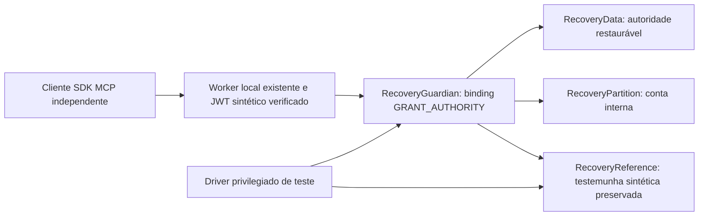

# B4 — 2B.2-R2 — Prova local sintética de recuperação

Base obrigatória: `72aee518d64ae25849cff3b8c92359bd1cd8d190`. Sem alteração de arquivos publicados, dependências, workflows, cofres B3.1 ou entrypoints existentes. **Não homologado para produção.** Não há configuração Wrangler, endpoint publicado, administração real ou credenciais reais.

## Composição implementada



O fixture `tests/fixtures/recovery-worker.ts` importa o Worker do protótipo sem modificá-lo. O harness fornece outra classe para o binding já existente `GRANT_AUTHORITY`, com o mesmo método `permissions`. Não existe nova rota HTTP administrativa. `account`, `listings` e `listing` mantêm implementação, schemas e perfis MCP `2026-07-28`/`2025-11-25` existentes. O driver usa stubs privados locais, não credenciais de operador nem ferramentas MCP de escrita.

`RecoveryReference` (W) representa a premissa de uma fonte linearizável, vigente e durável fora do domínio restaurado. Mantém estado de segurança integral, digest SHA-256 canônico, revisão, gate e revisão do gate, intents, status idempotente, nonces consumidos e eventos históricos de revisão. Os eventos registram head/revisão e fase; não são uma solução de arquivo imutável ou ledger externo homologado. O estado atual integral em W permite reconstrução sintética; eventos isolados não são um backup completo de todos os estados anteriores.

A, P e G têm namespaces SQLite distintos de W. O snapshot comum do driver inclui G/A/P e **exclui W**. Há injeção explícita separada para comprometer W. Tudo executa no mesmo host/provedor local: **a separação é lógica e controlada, não prova de independência física, administrativa ou do provedor**. As APIs `fixture` e `rpc` são capacidades privilegiadas de teste; não devem ser implantadas nem expostas como API operacional.

## Estado, identidade e autorização

O schema fechado valida ambiente/enrollment/protocolo fixos, operadores pseudonimizados, contas e partições internas, anchors ativos/revogados e grants com read/connect, validade e revisão. A serialização normaliza conjuntos/ordem de chaves; mudanças no estado canônico mudam o digest. Não são criados grants, operadores habilitados ou identidades de confiança nos construtores/reinícios. A preparação explícita do laboratório inicializa uma referência **fechada**, faz reconciliação simulada e cria duas concessões sintéticas em operações separadas.

O JWT continua sendo validado pelo código B4 existente, incluindo assinatura, issuer/audience/sub/tempo. Claims adicionais não selecionam operador/conta nem conferem administração. G recebe o pseudônimo proveniente desse caminho; a conta informada é seletor sujeito à autorização. Cada leitura consulta novamente W, a autoridade e a projeção da conta. Não há cache de allow ou fallback em memória. Gate fechado, ausência, corrupção, dados antigos, falta de read ou validade incorreta negam. Read/connect permanecem distintos; nenhum concede administração.

A decisão usa nonce novo por operação e valida a view canônica completa contra W. Uma projeção residual de anchor já revogado não é autorizada. Anchor ativo com projeção divergente bloqueia. O binding interno existente oferece identidade/conta/permissão; a composição não adiciona assinatura cross-account nem vinculação criptográfica ao hash dos argumentos da ferramenta. Os schemas/roteamento e a validação de cada chamada MCP continuam no Worker existente. A futura fronteira externa autenticada exige projeto e homologação próprios.

## Reinício, indisponibilidade e bloqueio persistente

READY no SQLite do guardião é diagnóstico, nunca autorização. Cada execução deve percorrer novamente a prova atual antes de retornar permissão. O modelo local demonstra perda de memória/cold start/eviction/hibernação por descarte e recriação de runtimes, preservando os bancos. Não simula a API real de hibernação Cloudflare.

G persiste latch `UNAVAILABLE` para indisponibilidade/quota reconhecidas; nenhuma chamada autoriza nessa condição. Após retorno, somente uma prova integral atual sem HOLD permite voltar a READY automaticamente. Divergência, corrupção ou falha não reconhecida persistem `RECOVERY_REQUIRED`; W recebe HOLD durável quando acessível. Esse bloqueio requer reconciliação simulada. Nenhum health check, timer ou ACTIVE restaurado o remove.

Se o próprio armazenamento estiver totalmente indisponível, é impossível garantir a gravação de um novo latch/evento naquele armazenamento: o código nega e não declara registro persistido. A próxima execução também precisa provar estado atual antes de autorizar. Esse limite não é convertido em fallback permissivo. O modelo testa erros controlados e corrupção SQLite identificada; não certifica o comportamento de discos do provedor.

Uma leitura durante PENDING recebe negação, sem comparar como corrupção a view anterior que ainda está sendo atualizada. Por conservadorismo, o latch local pode exigir reconciliação mesmo após uma mutação concorrente terminar; isso pode causar indisponibilidade adicional. Não se enfraquece a autorização para contornar esse efeito.

## Ordenação da revogação

1. Validar operação fechada e ator **simulado**, expectedSeq/expectedRevision e operationId/hash.
2. W faz CAS e grava alvo revogado/tombstone, intent, fence PENDING e evento em transação SQLite; aguarda durabilidade **antes de tocar A/P**.
3. G aplica e persiste a view da autoridade e projeções ativas. Projeção revogada antiga pode permanecer, sem poder autorizar.
4. W confere o alvo e finaliza head/status/evento duráveis; só depois G confirma ao driver.

Não há transação distribuída. Uma falha entre fases deixa deny/intent, nunca retoma grant anterior. A revogação é terminal para o par, inclusive após reconciliação. Status por operationId é consultável; repetir payload diferente é conflito. ACK perdido não cria outra operação. Os testes verificam fence, gravação de dados, confirmação e ACK, além de falhas durante decisão e recuperação. Injeções após `sync()` comprovam ordem de aplicação; não certificam falha física do flush ou SLA do provedor.

Uma chamada iniciada após ACK de revogação consulta W posterior e é negada. Chamadas cuja decisão ocorreu antes da revogação podem concluir. Há rechecagem do estado após awaits e da validade antes de devolver permissão. Não há cancelamento retroativo de dados já entregues ou respostas em voo.

## Reconciliação simulada

O plano é vinculado a nonce de uso único, operationId, root, sequência, revisão do gate, ambiente/enrollment e duas identidades **fictícias** distintas. O fixture exige papel proponente/revisor e indicador de MFA simulado recente, com expiração também conferida ao finalizar. Não comprova pessoa física, MFA, credenciamento ou Access operacional. `adminCount` é um controle de teste, sem afirmação de que existam dois administradores reais.

W fecha a recuperação antes da reconstrução. A/P/G só recebem estado vigente integral de W; nenhuma cópia antiga é promovida a fonte atual. Confere-se a reconstrução e finaliza-se por CAS, preservando revogações e consumindo o plano. Falha parcial mantém HOLD. Sem W confiável, quorum simulado ou prova atual, não existe liberação. Um checkpoint válido preservado em G não pode ser reduzido nem trocado por outro root na mesma sequência durante reconciliação. A perda de W não permite reenrollment por um G já inicializado; a cerimônia inicial não serve como reparo. O driver pode simular apenas um administrador e mostrar bloqueio; isso não implementa IAM real.

## Limite obrigatório: rollback da própria testemunha

Rollback de W contra checkpoint mais novo ainda preservado em G é detectável. Rollback conjunto de **W, G, A, P e evidências antigas** pode recriar um passado coerente e permitir leitura anteriormente revogada. `R1-63` exige observar esse contraexemplo; passar nesse teste significa demonstrar a limitação, não resolver a ameaça.

W não é hardware monotônico, um contador SQLite não resiste automaticamente a PITR, e outro namespace não torna backups invioláveis. Sem serviço independente com contrato de atualidade/continuidade homologado e controles reais de restore/delete/recriação, nenhuma alegação de segurança de produção é válida.

## Reprodução

Node 24. Instalação fixa pelos lockfiles originais; não atualizar dependências:

```sh
# Na raiz do checkout isolado
npm ci --ignore-scripts --cache <cache-local-gravavel>
npm run typecheck
npm test
node scripts/tooling.mjs test --config vitest.b3.config.ts
npm run test:registry
npm audit --audit-level=low

cd prototype/mcp-local
npm ci --ignore-scripts --cache <cache-local-gravavel>
npm run typecheck
npm exec -- tsc --noEmit -p tsconfig.persistence.json
npm exec -- tsc --noEmit -p tsconfig.recovery.json
npm run build:local
node --test tests/interoperability.test.mjs tests/hardening.test.mjs tests/persistence.test.mjs
node --test tests/recovery.test.mjs
npm run demo
npm audit --audit-level=low
```

O arquivo novo é descoberto por `tests/*.test.mjs` no script npm existente. Seu build de fixture é local no início da suíte. O workflow existente não foi alterado; o typecheck dedicado `tsconfig.recovery.json` precisará ser explicitamente incluído numa futura proposta de CI se a incorporação for aprovada. Nesta rodada não houve execução GitHub Actions nem publicação.

A suíte R2 contém os 80 IDs planejados, com PITR real explicitamente pendente, e verificações complementares R2-S01 a R2-S14. `work/recovery-coverage.json` registra apenas resultados concluídos; o exit code/resumo do runner também deve ser conferido para não ocultar falhas ou teardown. O cenário de comprometimento integral é classificado separadamente como limite demonstrado.

Todos os recursos são encerrados e as portas verificadas como recusando conexão. Snapshots físicos/corrupção operam somente em diretórios temporários criados pela suíte, com runtimes fechados. Não se executa PITR Cloudflare. O harness bloqueia e conta tentativas de saída; as chaves efêmeras são geradas em memória, sem persistência ou impressão. Textos de anúncios continuam dados não confiáveis do protótipo original.

## Pendências antes de qualquer operação real

Escolha/homologação da referência externa e seu domínio de falha; proteção contra rollback dela própria; PITR/IAM e ciclo de vida Cloudflare reais; canal autenticado e replay entre contas; credenciamento e MFA por ação; quorum real sem presumir segundo responsável; retenção/limites de nonces e auditoria; capacidade/latência/custos; disponibilidade durante mutações; testes de recuperação operacional autorizados. O histórico e as tabelas de nonces crescem sem política de retenção operacional neste laboratório.

Nenhuma conexão Mercado Livre/ChatGPT, cofre operacional, ferramenta comercial de escrita ou Fase 2B.2-B foi iniciada. Código e resultados devem ser auditados antes de proposta de versionamento, que exige nova autorização.
