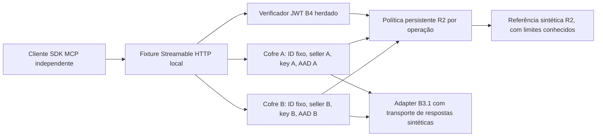

# B4 — 2B.2-B — Isolamento sintético de cofres

Base: `3c942f5694ffe45a3026356820f5255504d6199c`, branch de referência `b4/cloudflare-access-mcp`. Desenvolvimento somente local. Nenhum cofre operacional, conta real, OAuth real, recurso Cloudflare ou endpoint externo é criado. **Não homologado para produção.**

## Composição



Os entrypoints existentes não são alterados. O novo `tests/fixtures/vault-worker.ts` reproduz as verificações HTTP do fixture MCP e compõe um servidor novo, as classes R2 herdadas e uma classe SQLite nova `SyntheticAccountVault`. A composição não substitui classes, bancos, namespaces ou bindings operacionais. O SDK, protocolos `2026-07-28` e `2025-11-25`, schemas, descrições, nomes, envelopes e annotations das ferramentas `account`, `listings` e `listing` são preservados; um cliente independente compara a descoberta com o servidor original.

O código novo fica em `vault/`, fora de `src/` herdado. `tsconfig.vault.json` verifica explicitamente a nova composição. Não há arquivo Wrangler ou mecanismo de deploy para ela.

## Auditoria e reutilização B3.1

| Componente herdado | Reutilização / ressalva |
|---|---|
| `src/b3/vault.ts` | Padrão de DO SQLite por conta revisado. A classe existente usa configuração fixa e provider desabilitado; não é alterada nem reutilizada com configuração dinâmica não confiável. |
| `src/types.ts`, `src/vault/sqlite-store.ts` | Interfaces `VaultStore`/`TokenRow` e armazenamento SQLite reutilizados na classe nova. |
| `src/b3/token-service.ts` | `TokenCoordinator.withAccess` reutilizado com fachada imutável; aquisição automática de token não recebe autoridade para renovar. |
| `src/b3/keyring.ts`, `src/crypto.ts` | AES-GCM com chave distinta por conta, identificador de chave e AAD vinculado a ambiente/conta/vendedor/cofre. |
| `src/b3/adapter.ts`, `src/preparation/prepared-read-client.ts` | Adapter com seller esperado, deadline, limites e validação de identidade/item reutilizado. Transporte exclusivamente sintético injetado; nenhum `fetch` de rede. |
| `src/preparation/draft-contracts.ts` | Parsers herdados de respostas candidatas, sem alegação de contratos Mercado Livre homologados. A busca não inclui seller na resposta: composição verifica identidade e cada item separadamente. |
| `src/b4/local.ts`, política persistente e `recovery/` | Identidade derivada do JWT verificado, autorização R2 atual para read e callback B4 inalterados. |

`withAccess` da B3.1 pode renovar tokens próximos da expiração. Nesta composição, uma pré-verificação recusa tokens expirados ou a menos de 30 segundos da expiração, sem renovar. A fachada `VaultStore` bloqueia `putTokens`, `putState` e `takeState`; se o prazo cruzar entre awaits, a tentativa de gravar o marcador de refresh é recusada **antes** de alcançar o provider. `exchange` e `refresh` também estão desabilitados. Não se chama `connect`, `rotate` ou `revokeLocally` por ferramentas MCP. Read/connect não conferem administração. Falhas não alteram o token para contornar a recusa.

## Vínculo por operação

O registro imutável interno associa `account-a` a seller fictício `10001`, cofre `synthetic-vault-a`, key ID `synthetic-a`; `account-b` usa `20002`, `synthetic-vault-b`, `synthetic-b`. IDs comerciais sintéticos públicos são mapeados internamente para IDs numéricos fictícios usados pelo adapter herdado; não é possível passar um ID upstream arbitrário.

1. O transporte local valida host/origem/método/tamanho e autentica JWT assinado com JWKS efêmero local.
2. Cada chamada autentica o operador para a conta/permissão read na política persistente R2. Claims extras, query e cabeçalhos não selecionam vendedor, chave ou cofre.
3. O servidor seleciona o DO pelo registro interno e transmite somente conta, identidade verificada, prazo da identidade, nonce e operação/argumentos fechados.
4. O DO confere seu ID contra o ID esperado calculado pelo namespace, a conta persistida e a identidade cifrada completa. Não basta trocar todos os metadados de B para o banco de A.
5. Consulta R2 novamente, consome nonce de forma persistente e valida ciphertext, status ready, seller e tokens fictícios esperados. Cada conta tem chave e contexto distintos.
6. O coordinator recebe um store somente de leitura e um adapter de seller fixo. Identidade upstream deve corresponder ao seller; IDs de busca são limitados e cada item deve pertencer ao mesmo vendedor.
7. Após os awaits, confere armazenamento/token inalterado, consulta novamente R2 e verifica expiração da identidade antes de devolver dados.
8. Só campos previstos são serializados. Valores conhecidos de tokens/chaves de ambas as contas são recusados se aparecerem em campos textuais. Respostas continuam marcadas `untrusted_data: true`; textos não são interpretados como instruções.

Uma resposta já autorizada antes de uma revogação pode terminar em voo; não existe cancelamento retroativo. A verificação final impede liberar dados quando a revogação é observada durante o adapter. O modelo não oferece transação distribuída entre guardião, cofre e entrega HTTP.

## Persistência, replay e falhas

Tokens e identidade do cofre são cifrados; nonces e eventos são persistidos em tabelas próprias. Chaves e tokens fictícios são gerados em memória pelo driver. Reinícios normais reutilizam esse material apenas enquanto o processo de teste o mantém; perda da chave causa recusa, não regeneração automática ou provisionamento. O construtor só prepara schema: não cria tokens nem concessões. A preparação exige chamadas privilegiadas explícitas do driver.

Reutilizar um nonce já consumido é recusado também após reinício. Esse ledger é restaurável: não representa anti-replay externo ou um contador inviolável. JWT é um bearer reutilizável até expiração; cada nova chamada ainda depende da concessão vigente, e um JWT válido não recupera uma concessão revogada.

Indisponibilidade, registros ausentes, ciphertext inválido, troca de chave/contexto, identidade/vendedor incorretos e falhas desconhecidas negam. Erros do provider são sanitizados pelo adapter e pelo cofre, sem encaminhar mensagens arbitrárias. A falha sintética de armazenamento é persistida pelo fixture e exercitada após reinício. Não é certificação de falha física de disco ou SLA do Cloudflare. Se o armazenamento não puder registrar um evento, isso não produz autorização permissiva.

## Callback Mercado Livre

O callback público existente `/oauth/mercadolivre/callback` continua separado do endpoint `/mcp`. Nenhum arquivo de router/OAuth foi alterado. O fixture MCP novo não publica nem absorve esse callback: retorna 404 para a rota, antes da autenticação MCP. Os testes herdados de B3.1 e B4 revalidam callback público, state de uso único, cookie, PKCE, seller e checagem connect/revogação. Esta etapa não compõe conexão OAuth com os novos cofres nem inicia fluxo real.

## Testes e reprodução

Node 24, versões dos lockfiles originais; não atualizar dependências:

```sh
# raiz do checkout
npm ci --ignore-scripts --cache <cache-local-gravavel>
npm run typecheck
npm test
node scripts/tooling.mjs test --config vitest.b3.config.ts
npm run test:registry
node scripts/verify-b3-preservation.mjs
npm audit --audit-level=low

cd prototype/mcp-local
npm ci --ignore-scripts --cache <cache-local-gravavel>
npm run typecheck
npm exec -- tsc --noEmit -p tsconfig.persistence.json
npm exec -- tsc --noEmit -p tsconfig.recovery.json
npm exec -- tsc --noEmit -p tsconfig.vault.json
npm run build:local
node --test tests/vault-isolation.test.mjs
node --test tests/interoperability.test.mjs tests/hardening.test.mjs
node --test tests/persistence.test.mjs
node --test tests/recovery.test.mjs
npm run demo
npm audit --audit-level=low
```

O build de cada fixture é feito pela própria suíte. O harness usa o cleanup herdado: clientes, requests, timers de deadline, respostas e Miniflare encerrados em caminhos normais/de falha. Os testes verificam portas fechadas, contadores de recursos zerados e zero tentativas de egress. Manipulações de snapshot e limpeza operam apenas em diretórios temporários criados pela suíte.

Os cenários VB cobrem dois perfis MCP, dois operadores/contas, seleção indevida, read/connect, criptografia, vendedor incorreto, vazamentos por resposta/erro/eventos/wire, nonce, concorrência, revogação durante leitura, token alterado em voo, reinício, perda de chave, armazenamento, grant rollback e ausência de bootstrap. Os testes de rejeição usam contratos MCP explícitos; ECONNRESET/timeout/conexão recusada não contam como autorização corretamente negada. Relatório externo ao checkout registra contagem, tempos, hashes e cobertura individual.

## Limites e plano de incorporação

O mesmo runtime recebe as duas chaves para este laboratório. Separação de DOs e AAD provam barreiras contra troca de contexto/ciphertext no modelo, **não** independência de IAM, de processo, de administrador ou do provedor. Um invasor com controle do runtime/driver/material pode exercer capacidades privilegiadas; o protótipo não é defesa contra esse comprometimento. As APIs `fixture` e os stubs de teste nunca devem ser expostos operacionalmente. O filtro de segredos conhecidos não é DLP contra toda codificação/derivação arbitrária de dados.

Continuam pendentes rollback da referência confiável W, independência real do guardião, MFA/quórum administrativo operacional, PITR e recuperação real. Restaurar conjuntamente W/G/A/P e suas evidências pode reativar read sobre um cofre ainda utilizável. A criptografia de cofre não resolve esse rollback de autorização. Reconciliação R2 permanece simulada e não comprova MFA. Não existe gestão operacional de chaves, retenção/limpeza de nonces, rotação real ou migração de cofres nesta etapa.

**CI futuro exige aprovação adicional.** O workflow atual fixa inventário de quatro arquivos `.test.mjs`; a nova quinta suíte faz esse guard falhar. Não se deve publicar apenas estes arquivos e presumir cobertura automática. Proposta: aprovar conjuntamente as adições e uma atualização explícita do inventário, um quarto grupo `vault` e `tsconfig.vault.json`, mantendo MCP/persistência/R2 completos, regressões e auditorias. Não aumentar timeout sem medir a suíte. Nenhum workflow foi modificado nesta etapa; nenhum commit/push/PR/deploy foi executado.

Antes de incorporação: auditoria/hash dos arquivos, autorização expressa da Direção, validação do CI proposto, base remota reconfirmada e publicação coordenada com o CI aprovado. Antes de qualquer uso real: resolver os bloqueios de recuperação, isolar operacionalmente segredos e capacidades administrativas, homologar os contratos de vendedor e implementar refresh/connect em escopo próprio aprovado. Nenhuma funcionalidade comercial de escrita foi adicionada.
